# Server Waypoint

Server Waypoint adds shared waypoints to Minecraft servers. Players can browse, edit and navigate to waypoints through clickable chat without a client mod. The optional client mod adds a waypoint manager, in-world markers and minimap sync.

It runs on Fabric, Forge, NeoForge, Paper, Folia and Purpur. An optional Velocity plugin lets players browse and teleport to waypoints on other servers.

## Features

### Server (no client mod needed)

| Feature | Description |
| --- | --- |
| **Shared waypoints** | Named lists for each dimension. Waypoints have a color and initials, plus an optional item icon, description and keywords. |
| **Private waypoints** | Personal lists saved on the server and visible only to their owner. Open them with `/wp private`. |
| **Chat menus** | Browse, search, sort, add, edit and remove waypoints by clicking in chat. Hover over a waypoint for its details. |
| **Navigation** | Find your target with a compass, map, boss bar, action bar, floating label or world marker. Use one or several at once. |
| **Teleport** | Teleport to a waypoint from chat or the manager, if you have permission. |
| **Restore** | Removing a waypoint gives a Restore link that works once within 10 minutes. |
| **Cross-server** | Browse and teleport to waypoints on other servers behind a Velocity proxy, from chat or the manager. |
| **Styled text** | Display names and descriptions accept JSON text components for colors and formatting. |
| **Permissions** | Choose who can add, edit, remove, navigate, teleport and upload. Supports LuckPerms on Fabric and Paper. |
| **Translations** | Messages follow each player's language setting. Includes English, Chinese (Simplified, Traditional and Hong Kong), Spanish and Hebrew. |

### Client mod (optional)

| Feature | Description |
| --- | --- |
| **Waypoint manager** | Browse, search, edit, navigate and teleport from one screen. Open it with **Right Shift** or `/wp_gui`, and press **T** over a waypoint to teleport. |
| **In-world markers** | Visible waypoints appear in the world with their item icon, color and initials. Look at one to see its name and distance. |
| **Local waypoints** | Keep your own waypoints on the client, separately for each server or world. They work even on servers without Server Waypoint. |
| **Map mod sync** | Show shared waypoints in Xaero's Minimap or VoxelMap-Updated, and upload your map waypoints when permitted. |
| **Xaero's World Map** | Add and edit server waypoints from the world map's right-click menu. Requires Xaero's Minimap. |
| **Client settings** | Adjust marker size, range and opacity, the GUI theme and map sync. Press **C** in the manager. |

## Getting started

- **Server:** install the Fabric mod (with Fabric API), the Forge or NeoForge mod, or the [Paper plugin](https://modrinth.com/plugin/server_waypoint/versions?l=paper), which also runs on Folia and Purpur. Join and run `/wp`.
- **Client (optional):** install the Fabric, Forge or NeoForge mod on your client. It works with any of the server platforms above and in singleplayer.
- **Velocity (optional):** install the [Velocity plugin](https://modrinth.com/plugin/server_waypoint/versions?l=velocity) and enable cross-server support on each backend server. It is off by default and needs Java 25 on the proxy and matching Server Waypoint versions on every server.

By default, players can add, edit, remove and navigate. Teleporting and uploading require operator permission. Some features depend on the Minecraft version, such as item icons in chat (1.21.9 and later) and VoxelMap support on Forge and NeoForge.

[Quick start](https://github.com/2676959/server_waypoint/blob/master/README.md#your-first-waypoint) · [Server guide](https://github.com/2676959/server_waypoint/blob/master/docs/tips/server-guide.md) · [Velocity setup](https://github.com/2676959/server_waypoint/blob/master/docs/tips/server-guide.md#cross-server-teleport-setup) · [Features by Minecraft version](https://github.com/2676959/server_waypoint/blob/master/README.md#feature-availability-by-minecraft-version)

## Screenshots

### Chat menus

Run `/wp` to browse waypoints by dimension and list. Hover over a waypoint to see its description and coordinates, or click it for details and actions.

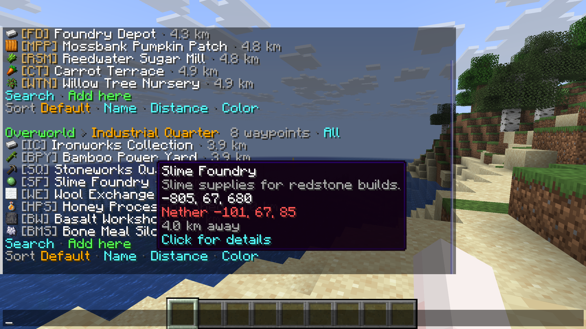

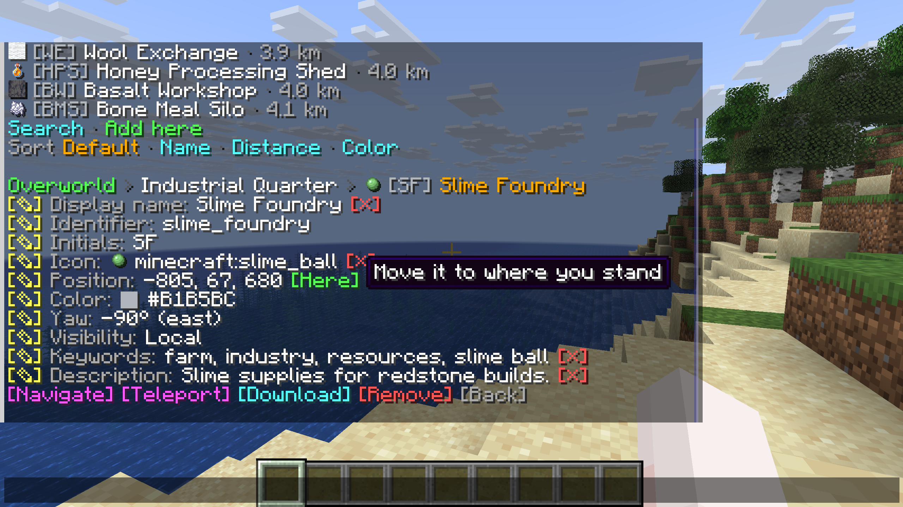

### Navigation

The compass, map, boss bar, action bar and floating label pointing to the same waypoint. Choose methods with `/wp navigate`.

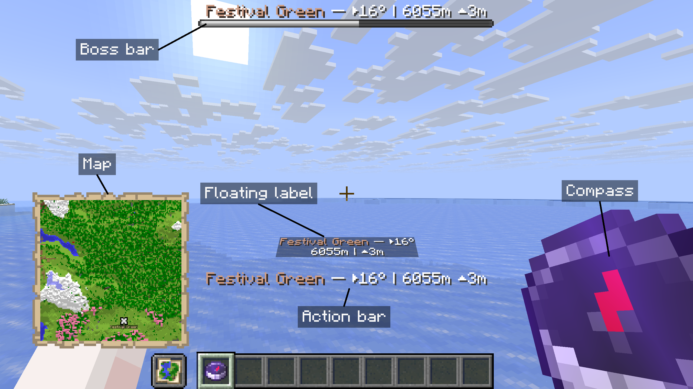

### Waypoint manager

Pick a dimension, search, and expand a list to see its waypoints. The details panel shows the selected waypoint's properties.

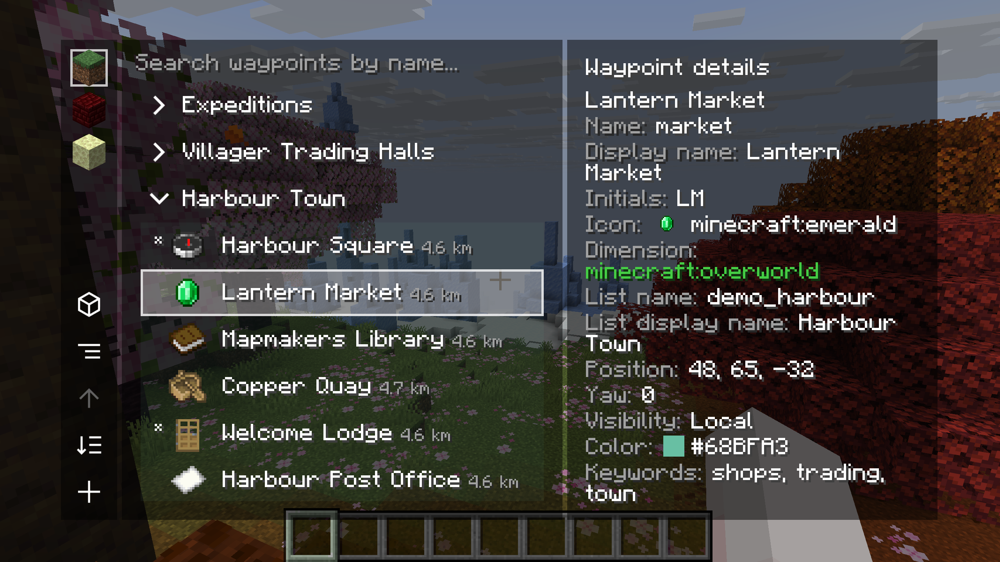

### In-world markers

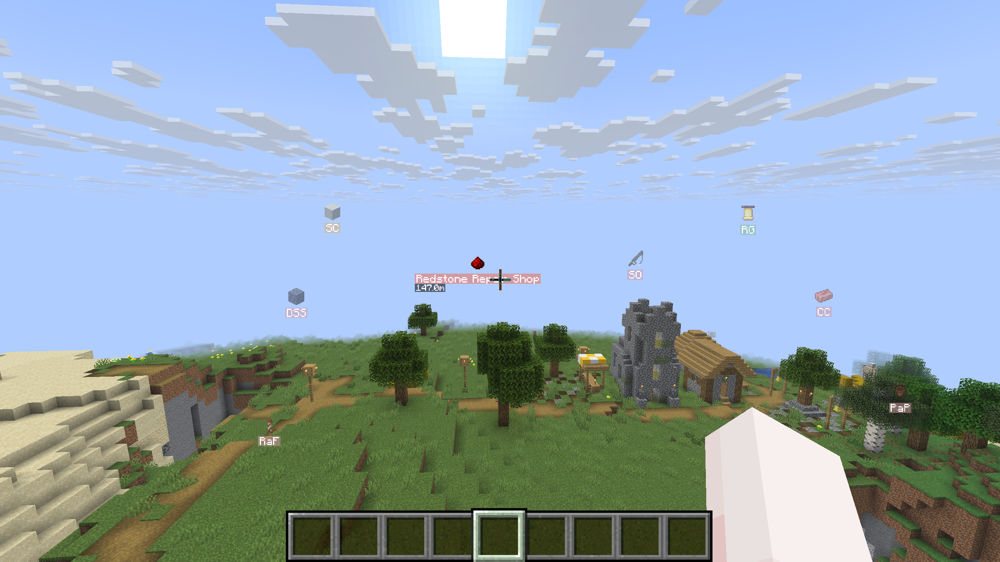

### Map mods

One shared waypoint in Xaero's Minimap, VoxelMap and the world. Client settings sync each map mod automatically or on demand.

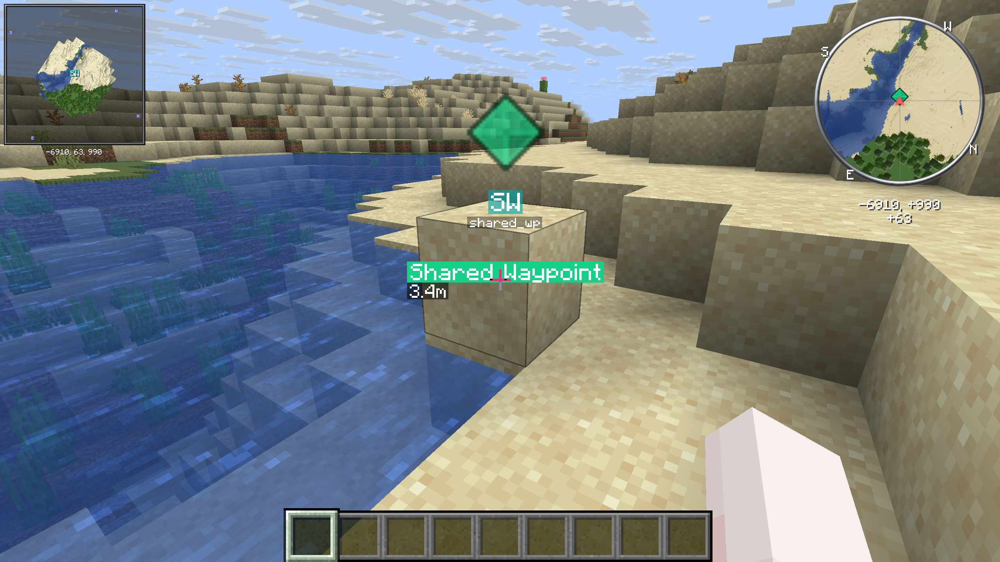

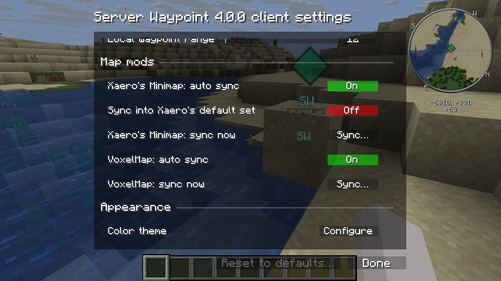

### Styled text

A display name and description written with JSON text components, shown in the manager and on an in-world marker.

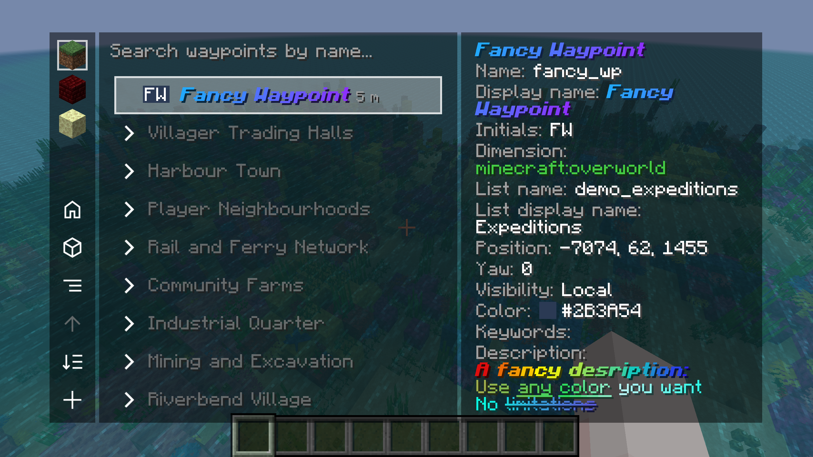

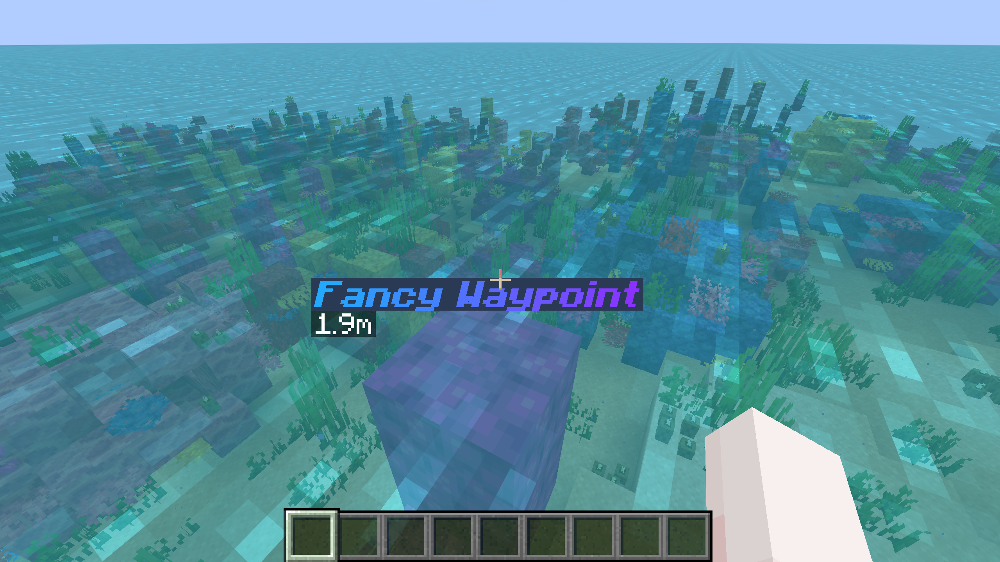

### Cross-server

`/wp remote` lists connected servers with their status and waypoint counts. The manager can browse another server's waypoints and teleport you there.

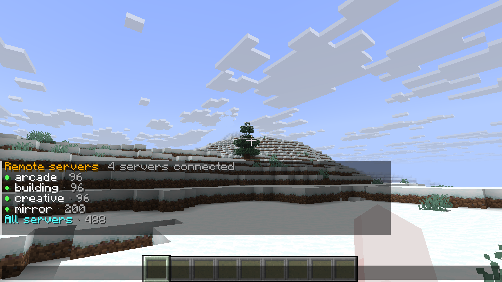

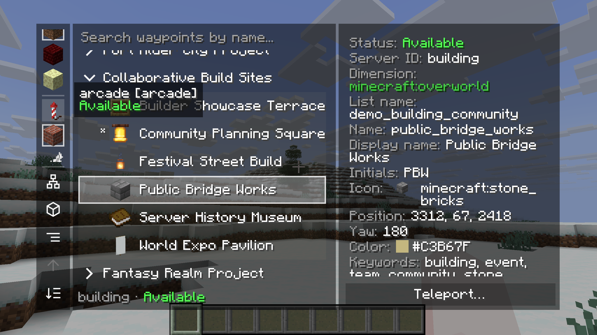

## Migrating from MCDR

Convert `locations.json` from the MCDReforged plugins Locations or LocationMarker with [locations2waypoints.py](https://github.com/2676959/server_waypoint/blob/master/locations2waypoints.py), which needs only Python 3. Follow the [migration steps](https://github.com/2676959/server_waypoint/blob/master/README.md#migrate-waypoints-from-mcdr-plugins) to back up your files and copy the output to the right folder.

## Links

- [Discord](https://discord.com/invite/tKtSSYDkHx): questions and community help
- [Issues](https://github.com/2676959/server_waypoint/issues): bug reports
- [Source code](https://github.com/2676959/server_waypoint)
- [Translation credits and review status](https://github.com/2676959/server_waypoint/blob/master/TRANSLATOR_CREDITS.md); help translate on [Crowdin](https://crowdin.com/project/server-waypoint)
