# Server Waypoint

## Make your world easier to explore.

Share destinations, guide your friends, and keep your server's favourite places together.

[Get started](https://github.com/2676959/server_waypoint#your-first-waypoint) | [Source code](https://github.com/2676959/server_waypoint)

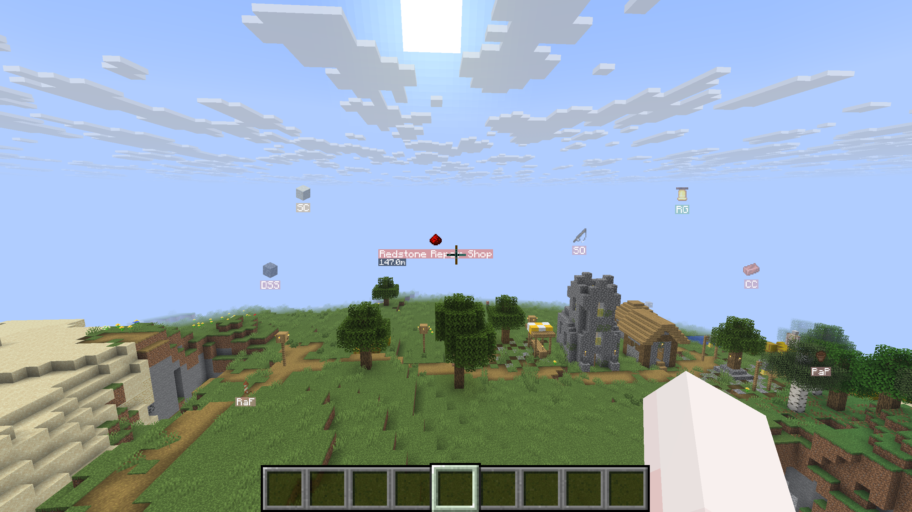

**Your spawn. Your community builds. Your next adventure.**

Save places once and help everyone find them. Use clickable chat with no client installation, or add the client mod for visual tools.

---

## Your server does the guiding

Join with vanilla Minecraft and let the server help you find your way. Interactive messages and navigation work without a client mod.

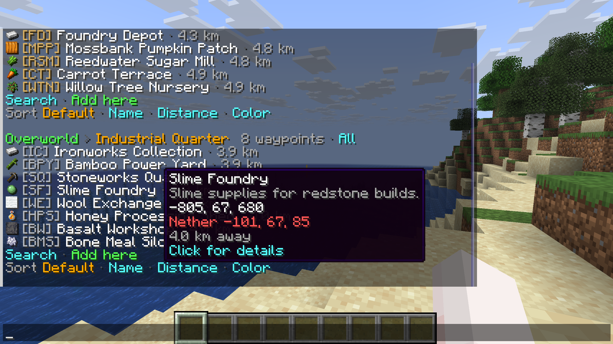

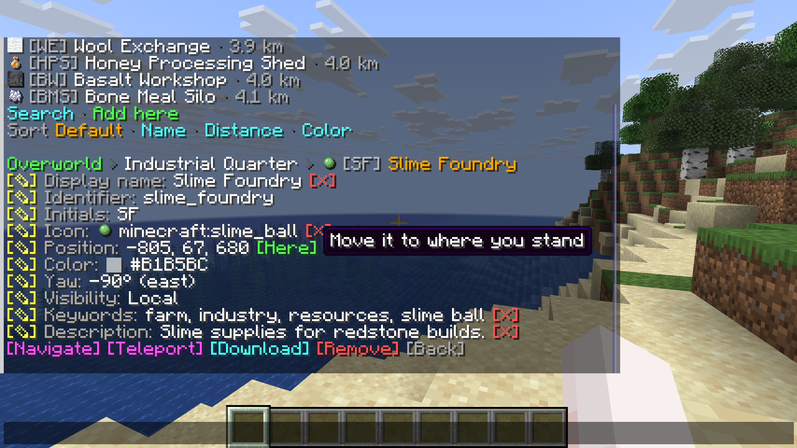

**Useful messages, ready to click.** Open `/wp` to browse lists, inspect destinations and choose your next action. Hover over buttons for help, follow edit links, or start navigating from chat. Feedback offers next steps, including a temporary **Restore** link after removing a waypoint.

**Guidance while you explore.** Follow a compass or map, keep your destination in a boss bar or action bar, or use a floating label in the world. Open `/wp navigate` to change your guidance methods or stop navigation.

**Shared places, controlled access.** Players can browse, edit and teleport according to the server's permissions. Messages follow each player's Minecraft language setting.

[Explore server commands](https://github.com/2676959/server_waypoint/blob/master/docs/tips/server-guide.md#commands)

## Across servers, closer together

Your survival town. A creative showcase. A community event on another server. Connect them with shared waypoints through the optional **Velocity** integration.

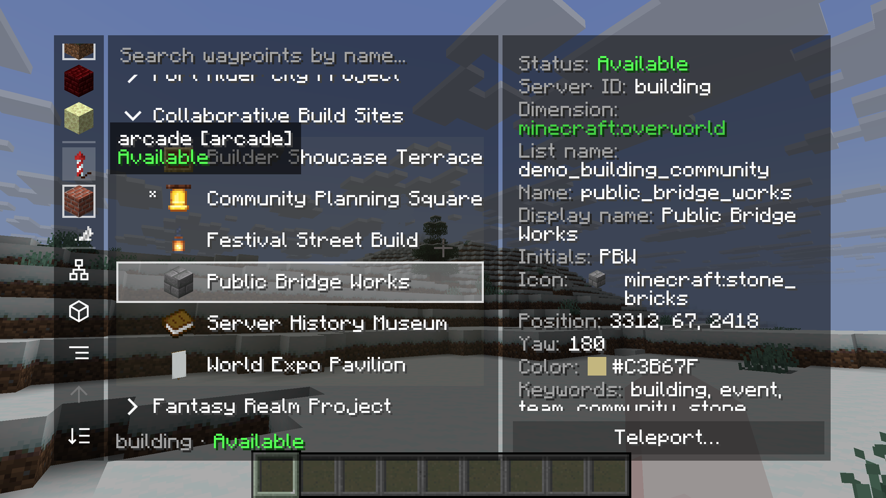

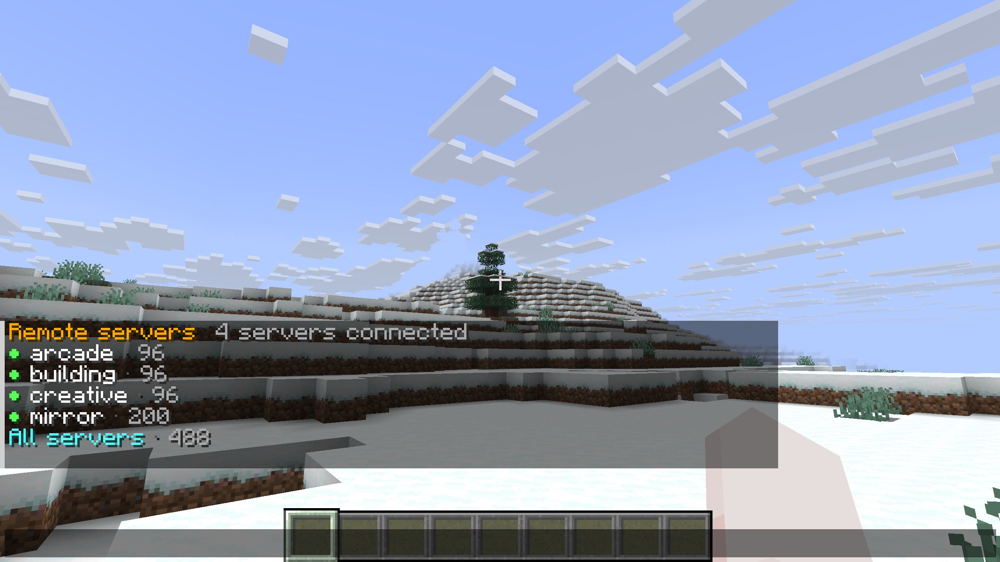

**Browse your network.** With the client mod, switch to **Remote server waypoints** in the manager, choose a server, and search its shared lists and destinations. See server availability and inspect each waypoint's details.

**Go straight to the destination.** Teleport to a shared waypoint on another server when your permissions allow it. Remote waypoints are edited on the server that owns them.

**Join with any client.** Use `/wp remote` and clickable chat to browse and teleport without the client mod.

[Set up cross-server waypoints](https://github.com/2676959/server_waypoint/blob/master/docs/tips/server-guide.md#cross-server-teleport-setup)

## Give every destination its own style

Make a market stand out in gold, give an expedition a colourful title, or highlight useful details in its description. Waypoint display names and descriptions support **JSON text components** with colours, bold, italics and mixed styles.

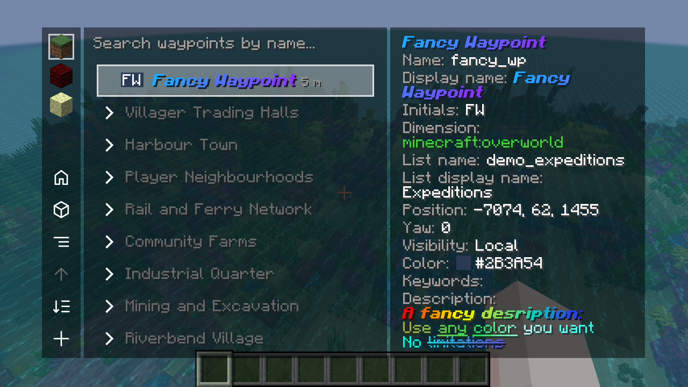

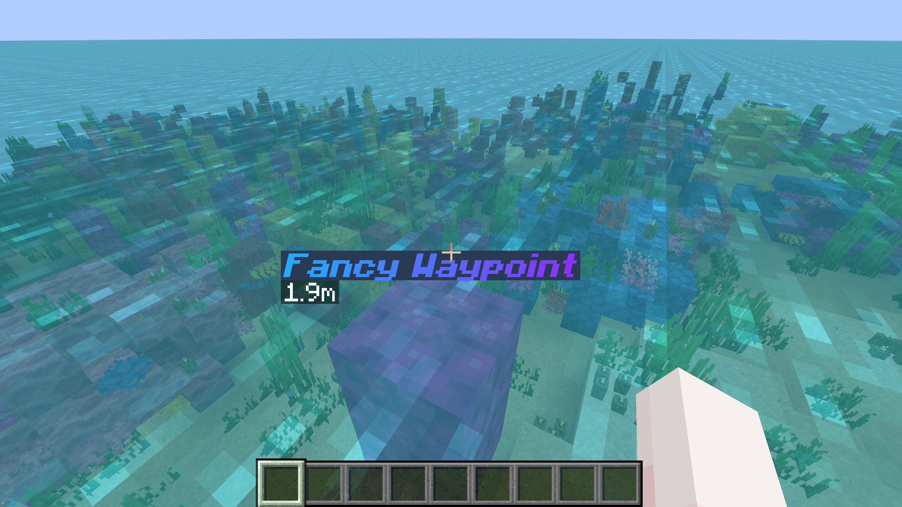

**A name with personality.** Combine styles within one display name. This example gives **Harbour** an aqua colour and **Market** bold gold text:

```json
{"text":"Harbour ","color":"aqua","extra":[{"text":"Market","color":"gold","bold":true}]}
```

**Descriptions worth reading.** Use the same JSON format to emphasise directions, opening hours or the story behind a place. Styled text appears in waypoint details and chat feedback, including for players without the client mod.

**Style the display, keep the identifier.** Give a waypoint a styled display name while keeping a simple identifier for commands and lookup. Edit its display name and description through the waypoint's edit controls or `/wp edit`.

[Learn about identifiers and display names](https://github.com/2676959/server_waypoint/blob/master/docs/tips/server-guide.md#identifiers-and-display-names)

## Your waypoints. Your favourite map.

Sync shared destinations to **Xaero's Minimap** or supported **VoxelMap-Updated** builds. Upload your own map waypoints when you have permission.

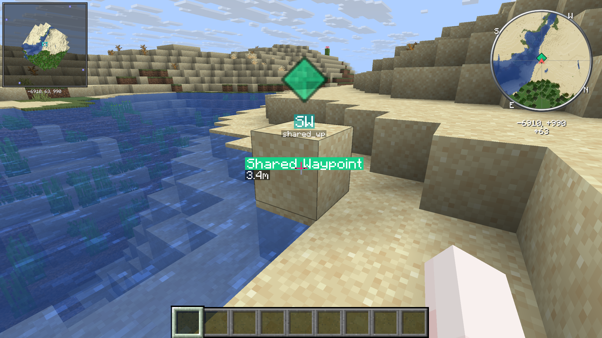

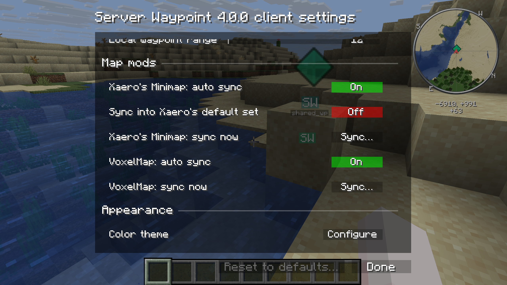

**Xaero's World Map** also offers actions for adding and editing server waypoints. Install Xaero's Minimap alongside it.

[Check map and version compatibility](https://github.com/2676959/server_waypoint#feature-availability-by-minecraft-version)

## A whole world, neatly organised

Find the trading hall, a friend's base or your next expedition. Browse by dimension, search your lists, and inspect each destination.

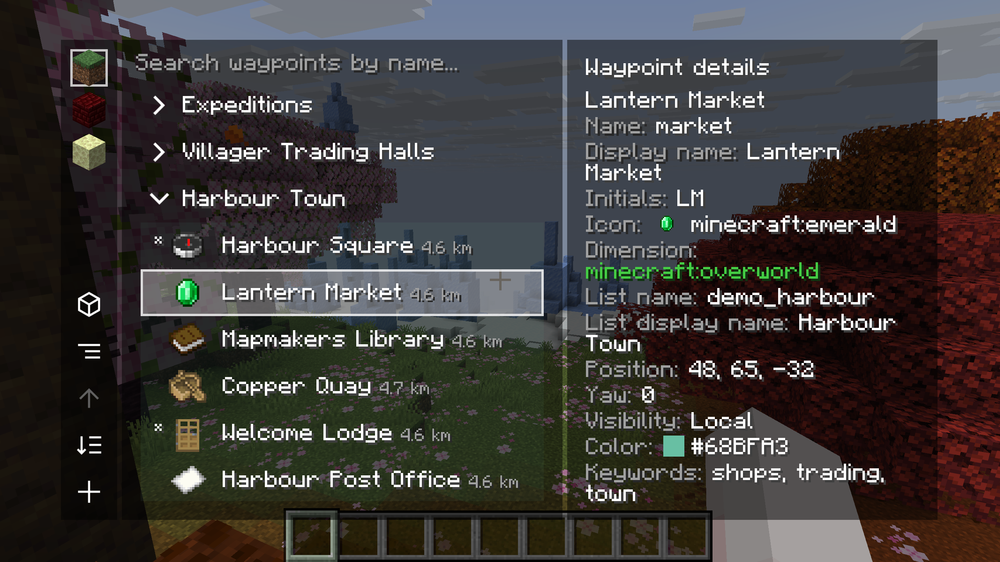

**Names that mean something.** Add descriptions, keywords, colours and icons. Group places into lists such as Harbour Town, Community Farms and Expeditions.

**Ready when you are.** Open the client manager with **Right Shift** or `/wp_gui`. Browse, edit, navigate or teleport with the server's permission.

## Follow the route your way

A compass in your hand. A floating label ahead. A destination on your map.

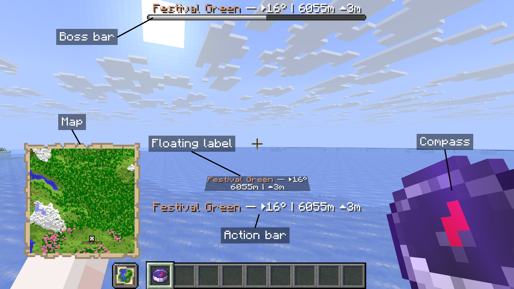

- **Server navigation:** compass, map, boss bar, action bar and floating labels.
- **Client markers:** configurable size, range and opacity.
- **Teleportation:** local destinations and, with Velocity configured, shared waypoints on connected servers.

> **No client mod required** for commands, clickable chat and server-provided navigation.

---

## Install it your way

**For a server**

Use the matching **Fabric, Forge or NeoForge** mod, or the **Paper, Folia or Purpur** plugin. Join and run `/wp`.

**For the full visual experience**

Install the client mod and the download's required dependencies. Fabric requires Fabric API. Singleplayer is supported too.

**For a connected network**

Add the optional **Velocity** plugin and configure your backends. Cross-server support is off by default and requires matching versions. The proxy plugin requires Java 25.

[Server setup and permissions](https://github.com/2676959/server_waypoint/blob/master/docs/tips/server-guide.md)

## Build somewhere worth finding

[Community Discord](https://discord.com/invite/tKtSSYDkHx) | [Report a bug](https://github.com/2676959/server_waypoint/issues) | [Help translate](https://crowdin.com/project/server-waypoint)

Messages follow each player's Minecraft language setting. [Translation credits and review status](https://github.com/2676959/server_waypoint/blob/master/TRANSLATOR_CREDITS.md).

<!-- Publishing note: This description targets 4.0.0 and uses real captures from the project gallery. The navigation screenshot includes added explanatory labels. For external publication, upload the images to the destination platform or public image hosting and replace the relative gallery links. See gallery/4.0.0/README.md for capture details and originals. -->
